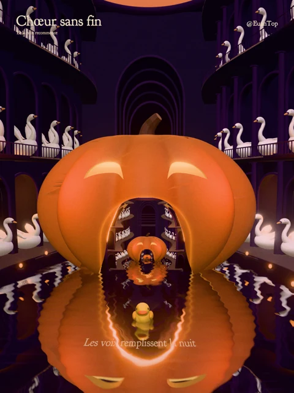

<div align="center">
<h1>Chœur sans fin</h1>
<p>A world inside a pumpkin. Another lantern inside that world.</p>
<p><b>English</b> · <a href="README.zh-CN.md">简体中文</a></p>
<p></p>
</div>

Released on 1 November 2026.

A real-time Three.js artwork by @EuanTop. A yellow duck swims through purple light halls nested inside hollow pumpkin lanterns. One duck stays with the camera as the continuous 32-second pullback moves from one scale to the next; swans sing from the curved arcades.

```sh
npm ci
npm run dev
```

Open `http://127.0.0.1:5176/`. Default framing is 3:4 portrait, with a deep violet palette and animated analog grain. Both the palette and grain can be changed in the panel. The collapsible panel controls time, swimming, water movement, light and viewpoint, with PNG capture. Enable music in the panel to hear the original synthesized choir and organ score. Side glances and wing gestures share its cue times. A supplied French reading is placed between choral phrases, with poetry fading on the river surface ahead of the duck. The approved Voice B recording is included; Poem volume remains independently adjustable, initially 222%. The panel and `npm run export` share a frame-accurate MP4 job: 1440×1920 H.264/AAC by default, with optional 2880×3840 HEVC/AAC via `npm run export -- portrait-4k`. Frames stream directly into MP4; no lossless master is generated. After full verification, `artifacts/exports/latest/share.mp4` points to the newest film and superseded automatic exports are removed. Failed or canceled jobs preserve the previous film.

```sh
npm test
npm run build
```

`src/lantern/` contains the hollow shell, arcades, materials, water, character, lighting and scale cycle. The recursive transform `F(x) = 0.2x + (0, 0, -3.6)` shares a fixed point with the pullback, allowing each parent world to replace its child at the loop boundary. Six shared-geometry levels approximate the endless scene.

The local `/__art` API shares panel state and supports exact-time PNG jobs, video export, cancellation and renderer diagnostics. See [control API](docs/control.md) and [credits](docs/credits.md). Generated media and private material stay in ignored `artifacts/`.

The selected French reading is bundled as the regular runtime file `public/audio/poem-fr-b.wav`. The other takes and generated audio are excluded. The original score is synthesized in the browser; no external audio service is required. Checksums and phrase alignment live in `src/music/poem.ts`.

For local captures and exports, create `artifacts/` first (`mkdir -p artifacts`) if your clone has no output directory. A local Chromium installation and FFmpeg are required for video export.
