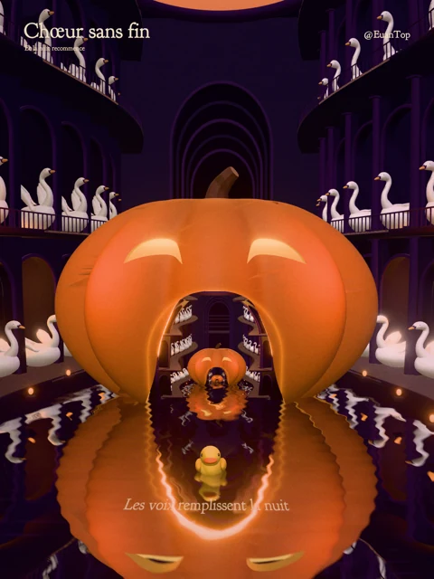

<div align="center">
<h1>无尽合唱 · Chœur sans fin</h1>
<p>南瓜灯里有一个世界，世界里还有一盏灯。</p>
<p><a href="README.md">English</a> · <b>简体中文</b></p>
<p></p>
</div>

发布于 2026 年 11 月 1 日。

@EuanTop 的 Three.js 实时作品。镜头跟随一只小黄鸭，嵌在空心南瓜里的紫色光厅不断延伸；弧形门廊中的天鹅组成合唱队。完整尺度循环为 32 秒。

```sh
npm ci
npm run dev
```

打开 `http://127.0.0.1:5176/`，默认 3:4 竖屏、深紫配色与动态模拟颗粒；面板可切换旧配色或关闭颗粒。可收起面板提供时间、游动、水纹、灯光、视角调节与 PNG 截图。面板内可开启原创合唱与管风琴配乐；侧头、抖翅与音乐共用提示点。法语朗诵穿插于合唱之间，诗句固定在鸭子前方的河面上渐隐渐现，随工程附带最终选中的 Voice B 录音，面板保留独立朗诵音量调节，默认 222%。面板和 `npm run export` 共用逐帧 MP4 任务：默认 1440×1920 H.264/AAC，`npm run export -- portrait-4k` 可选 2880×3840 HEVC/AAC。帧直接编码为 MP4，不生成无损母版。完整验证后更新 `artifacts/exports/latest/share.mp4` 并清理旧自动导出；失败或取消保留上一份可用成片。

```sh
npm test
npm run build
```

`src/lantern/` 按空心南瓜、廊道、材质、水面、角色、灯光与尺度循环拆分。递归变换 `F(x) = 0.2x + (0, 0, -3.6)` 与后退运动共用不动点，循环接点由外层世界接替内层；六层共享几何近似无限空间。

本机 `/__art` API 与面板共用状态，支持精确时间 PNG、视频导出、取消任务与渲染诊断。参见[控制接口](docs/control.md)和[致谢](docs/credits.md)。生成媒体与私人资料位于被忽略的 `artifacts/`。

最终法语朗诵作为普通运行文件 `public/audio/poem-fr-b.wav` 随工程提供，其他候选录音与生成音频不入 Git。原创配乐在浏览器内合成，无需外部音频服务。文件校验与分句时间位于 `src/music/poem.ts`。

本机截图或导出前，如克隆目录没有产物目录，请先创建 `artifacts/`（`mkdir -p artifacts`）。视频导出需要本机 Chromium 与 FFmpeg。
